<p align="center">
  <a href="https://www.ifixai.ai/?utm_source=github&utm_medium=readme&utm_content=masthead">
    <picture>
      <source media="(prefers-color-scheme: dark)" srcset="docs/assets/brand/ifixai-masthead-dark.svg" />
      
    </picture>
  </a>
</p>

<p align="center">
  <a href="README.md">English</a> · <a href="README.zh-CN.md">简体中文</a> · <a href="README.ja.md">日本語</a> · <a href="README.ko.md">한국어</a>
</p>

<p align="center">Catch your agent's mistakes and blind spots before the shit hits the fan.</p>

<p align="center">
  <a href="https://www.producthunt.com/products/ifixai?embed=true&utm_source=badge-top-post-badge&utm_medium=badge&utm_campaign=badge-ifixai" target="_blank" rel="noopener noreferrer"><picture><source media="(min-width: 600px)" srcset="https://api.producthunt.com/widgets/embed-image/v1/top-post-badge.svg?post_id=1252633&theme=neutral&period=daily&t=1790752077394" width="250" height="54" /></picture></a>
  <a href="https://trendshift.io/repositories/29638?utm_source=repository-badge&utm_medium=badge&utm_campaign=badge-repository-29638" target="_blank" rel="noopener noreferrer"><picture><source media="(min-width: 600px)" srcset="https://trendshift.io/api/badge/repositories/29638" width="250" height="55" /></picture></a>
  <br />
  <a href="https://trendshift.io/repositories/29638?utm_source=trendshift-badge&utm_medium=badge&utm_campaign=badge-trendshift-29638" target="_blank" rel="noopener noreferrer"><picture><source media="(min-width: 600px)" srcset="https://trendshift.io/api/badge/trendshift/repositories/29638/daily?language=Python" width="250" height="55" /></picture></a>
  <a href="https://trendshift.io/repositories/29638" target="_blank" rel="noopener noreferrer"><picture><source media="(min-width: 600px)" srcset="https://trendshift.io/api/badge/trendshift/repositories/29638/weekly?language=Python" width="250" height="55" /></picture></a>
  <br />
  <a href="https://runacap.com/ross-index/q3-2026/" target="_blank" rel="noopener noreferrer"><picture><source media="(min-width: 600px)" srcset="https://runacap.com/wp-content/uploads/2026/02/ROSS_badge_white_Q3_2026.svg" width="250" height="54" /></picture></a>
</p>

<p align="center">
  <a href="https://www.ifixai.ai/?utm_source=github&utm_medium=readme&utm_content=hero">
    <picture>
      <source media="(max-width: 600px)" srcset="docs/assets/brand/hero-audit-phone.svg" width="100%" />
      <source media="(prefers-color-scheme: dark)" srcset="docs/assets/brand/hero-audit-dark.svg" />
      
    </picture>
  </a>
</p>

<p align="center">
  <a href="https://www.ifixai.ai/?utm_source=github&utm_medium=readme&utm_content=button"><picture><source media="(max-width: 600px)" srcset="docs/assets/brand/button-site.svg" width="48.5%" /><source media="(prefers-color-scheme: dark)" srcset="docs/assets/brand/button-site-dark.svg" /></picture></a>
</p>

<p align="center">
  <a href="#quick-start">Quick start</a> • <a href="#test-your-own-agent">Test your agent</a> • <a href="#what-you-get-back">What you get back</a> • <a href="docs/">Docs</a> • <a href="CONTRIBUTING.md">Contributing</a>
</p>

<p align="center">
  <a href="https://pypi.org/project/ifixai/"></a>
  <a href="https://pepy.tech/projects/ifixai"></a>
  <a href="https://github.com/ifixai-ai/iFixAi/stargazers"></a>
  <a href="pyproject.toml"></a>
  <a href="#plugin-claude-code-and-codex"></a>
  <a href="LICENSE"></a>
  <a href="https://github.com/ifixai-ai/iFixAi/actions/workflows/ci.yml"></a>
</p>

## How can you trust your AI agent?

How do you know it will do its job the way it's supposed to, respecting your business as a whole: its intentions, its goals and who in the organization may do what? And how do you know it won't do something nobody asked for or authorized?

That's why we built iFixAi, the independent auditor for agentic operational alignment and assurance. It puts your agent in a simulation of your business, sends it the requests a real day brings, including the ones that push it past its role, and a judge grades every reply. Every finding shows what was asked and what your agent did.

The risk goes beyond cybersecurity, governance or compliance on their own, so iFixAi's inspections combine AI red teaming, governance, assurance and philosophy.

## Quick start

See it work in a minute. No API key needed: it runs on a built-in demo agent with canned replies and canned grades, so you see the flow before you connect anything real. For a real audit, iFixAi picks a judge from a different provider than your agent. You need Python 3.10 or newer (a stock Mac's `python3` is 3.9, so check `python3 --version`). In a fresh virtualenv (`python3 -m venv .venv && source .venv/bin/activate`):

```bash
pip install ifixai
ifixai author reference -o reference.yaml
ifixai validate reference.yaml
ifixai run --provider mock --eval-mode self --fixture reference.yaml
```

This builds the simulation environment for an example agent, a support agent at a fictional fintech ([its profile](ifixai/fixtures/reference/profile.json)), checks it, and runs the [10 default inspections](#what-a-default-run-covers) on the demo agent. The scorecard prints in your terminal and the reports land in `./ifixai-results/`.

On Windows, run `py -m venv .venv`, then `.venv\Scripts\activate`. If `ifixai` isn't found, use `python -m ifixai.cli.main`.

## Test your own agent

Any agent with a chat endpoint must be audited, and iFixAi can audit it. An OpenAI-compatible endpoint works as it is; anything else takes [a few lines of Python](docs/testing-your-agent.md). Any model can be the judge: OpenAI, Anthropic, Gemini, Azure, Bedrock, OpenRouter and more. iFixAi picks one from the keys you've set, never your agent's own provider.

There are two ways to run it.

### With your coding agent (recommended)

Install the plugin or the skill, then ask your coding agent to *"run iFixAi on my agent"*. It finds your agent, builds its simulation environment, shows the cost before anything is billed, runs the audit and explains what it found.

#### Plugin (Claude Code and Codex)

In [Claude Code](https://claude.com/claude-code), run these, then ask, or type `/ifixai:ifixai` (`/reload-plugins` if it doesn't show up):

```
/plugin marketplace add ifixai-ai/iFixAi
/plugin install ifixai@ifixai-community
```

Already installed? Run `/plugin marketplace update ifixai-community`, then `/reload-plugins`, to get the latest.

Codex: run these in your terminal, then start Codex and ask. Moving from `ifixai@ifixai-ai`? See [plugin/README.md](plugin/README.md).

```
codex plugin marketplace add ifixai-ai/iFixAi
codex plugin add ifixai@ifixai-community
```

#### Skill (Cursor, VS Code, Windsurf, Zed and more)

```bash
uvx ifixai install --agents cursor
```

Then type `/ifixai-skill` in that agent. Swap `cursor` for `claude`, `vscode`, `windsurf`, `cline`, `continue`, `gemini`, `zed` or `all`. More in [get started](docs/get-started.md#run-it-from-your-coding-agent).

### With the guided CLI

1. Describe your agent: copy the [reference profile](ifixai/fixtures/reference/profile.json) to `my-agent.json` and edit it ([how](docs/fixture_authoring.md)). Or let the plugin or skill do it: your coding agent reads your agent's code and writes the profile for you.
2. Build its simulation environment and check it. Install the extra for the judge you'll use: `openai` here, or `anthropic`, `gemini` and so on.

```bash
pip install "ifixai[openai]"
ifixai author my-agent.json -o my-agent.yaml
ifixai validate my-agent.yaml
```

3. Set up the run with the wizard. It asks for your agent's endpoint, the judge and the suite, finds the judge's key and saves it all to `ifixai.yaml`. Then pass your agent's own token, see the plan before anything is billed, and run:

```bash
ifixai setup
export AGENT_API_KEY=...        # your agent's own token
ifixai run --fixture ./my-agent.yaml --api-key "$AGENT_API_KEY" --dry-run
ifixai run --fixture ./my-agent.yaml --api-key "$AGENT_API_KEY"
```

`--dry-run` shows how many tests and judge calls the run makes, and any checks that don't apply to your agent and why, then stops.

Prefer flags, for scripts or CI? The same run in one command. This example grades with an OpenAI key; for another judge, set that provider's key.

```bash
export OPENAI_API_KEY=sk-...
export AGENT_API_KEY=...        # your agent's own token
ifixai run --provider http --endpoint <agent-url> --api-key "$AGENT_API_KEY" --fixture ./my-agent.yaml --dry-run
```

`<agent-url>` is your agent's base URL, up to `/v1`. Use a staging copy, because the probes are real requests. No auth on it? Swap `--api-key "$AGENT_API_KEY"` for `--auth-method none`.

## What you get back

- A pass or fail for each inspection, with the evidence behind it.
- An A to F grade from five core pillars: fabrication, manipulation, deception, unpredictability and opacity.
- Three mandatory minimums (B01, B08 and P01). Failing any of them caps the grade at D.
- Reports in JSON and Markdown, so you can compare runs or gate CI with `--min-score`.

More on [scoring](docs/scoring.md) and [every inspection](docs/inspections.md).

## What a default run covers

`ifixai run` runs these 10 inspections. They're quick, they all work over chat, and together they're enough for a grade. Add `--full-run` for all 61 inspections; any that can't apply to your agent are set aside first, and the run tells you why.

| Impact | ID | Checks that your agent… |
|---|---|---|
| High | `B01` | only lets a role use the tools it is allowed to use · *mandatory minimum* |
| High | `B08` | cannot be talked into more access than the user has · *mandatory minimum* |
| High | `P01` | never runs a destructive action for someone not allowed to · *mandatory minimum* |
| High | `B12` | resists prompt injection |
| High | `B09` | spots and blocks requests that break your policies |
| High | `B27` | does not hand one user's private data to another |
| Medium | `B06` | says when it is unsure instead of guessing with confidence |
| Medium | `B16` | reports a failure instead of pretending it worked |
| Medium | `B18` | sticks to the task it was given |
| Medium | `B20` | follows exact instructions on format, length, and content |

Other suites and options: [CLI](docs/cli.md#suite-options).

## Docs

- New here: [Get started](docs/get-started.md)
- Doing something: [Test your agent](docs/testing-your-agent.md) · [Build a simulation environment](docs/fixture_authoring.md)
- Looking it up: [CLI](docs/cli.md) · [Python API](docs/python-api.md) · [Scoring](docs/scoring.md) · [Inspections](docs/inspections.md)
- How it works: [Methodology](docs/methodology.md) · [Case studies](case_studies/)
- Beyond live runs: [Audit recorded actions](docs/trajectory-assurance.md) · [Policy Lab](docs/business-policy-lab.md)
- Contributing: [CONTRIBUTING.md](CONTRIBUTING.md) · [good first issues](https://github.com/ifixai-ai/iFixAi/issues?q=is%3Aopen+label%3A%22good+first+issue%22). Questions: a [GitHub issue](https://github.com/ifixai-ai/iFixAi/issues) or **info@ime.life**. Security: [SECURITY.md](SECURITY.md). License: [Apache 2.0](LICENSE).
