<p align="center">
  <a href="https://www.ifixai.ai/?utm_source=github&utm_medium=readme&utm_content=masthead">
    <picture>
      <source media="(prefers-color-scheme: dark)" srcset="docs/assets/brand/ifixai-masthead-dark.svg" />
      
    </picture>
  </a>
</p>

<p align="center">
  <a href="README.md">English</a> · <a href="README.zh-CN.md">简体中文</a> · <a href="README.ja.md">日本語</a> · <a href="README.ko.md">한국어</a>
</p>

<p align="center"><strong>AI 运行偏差诊断工具</strong></p>
<p align="center">在问题失控之前，发现智能体的错误和盲区。</p>

<p align="center">
  <a href="https://www.producthunt.com/products/ifixai?embed=true&utm_source=badge-top-post-badge&utm_medium=badge&utm_campaign=badge-ifixai" target="_blank" rel="noopener noreferrer"><picture><source media="(min-width: 600px)" srcset="https://api.producthunt.com/widgets/embed-image/v1/top-post-badge.svg?post_id=1252633&theme=neutral&period=daily&t=1790752077394" width="250" height="54" /></picture></a>
  <a href="https://trendshift.io/repositories/29638?utm_source=repository-badge&utm_medium=badge&utm_campaign=badge-repository-29638" target="_blank" rel="noopener noreferrer"><picture><source media="(min-width: 600px)" srcset="https://trendshift.io/api/badge/repositories/29638" width="250" height="55" /></picture></a>
  <br />
  <a href="https://trendshift.io/repositories/29638?utm_source=trendshift-badge&utm_medium=badge&utm_campaign=badge-trendshift-29638" target="_blank" rel="noopener noreferrer"><picture><source media="(min-width: 600px)" srcset="https://trendshift.io/api/badge/trendshift/repositories/29638/daily?language=Python" width="250" height="55" /></picture></a>
  <a href="https://trendshift.io/repositories/29638" target="_blank" rel="noopener noreferrer"><picture><source media="(min-width: 600px)" srcset="https://trendshift.io/api/badge/trendshift/repositories/29638/weekly?language=Python" width="250" height="55" /></picture></a>
  <br />
  <a href="https://runacap.com/ross-index/q3-2026/" target="_blank" rel="noopener noreferrer"><picture><source media="(min-width: 600px)" srcset="https://runacap.com/wp-content/uploads/2026/02/ROSS_badge_white_Q3_2026.svg" width="250" height="54" /></picture></a>
</p>

<p align="center">
  <a href="https://www.ifixai.ai/?utm_source=github&utm_medium=readme&utm_content=hero">
    <picture>
      <source media="(max-width: 600px)" srcset="docs/assets/brand/hero-audit-phone.svg" width="100%" />
      <source media="(prefers-color-scheme: dark)" srcset="docs/assets/brand/hero-audit-dark.svg" />
      
    </picture>
  </a>
</p>

<p align="center">
  <a href="https://www.ifixai.ai/?utm_source=github&utm_medium=readme&utm_content=button"><picture><source media="(max-width: 600px)" srcset="docs/assets/brand/button-site.svg" width="48.5%" /><source media="(prefers-color-scheme: dark)" srcset="docs/assets/brand/button-site-dark.svg" /></picture></a>
</p>

<p align="center">
  <a href="#快速开始">快速开始</a> • <a href="#测试你自己的智能体">测试你的智能体</a> • <a href="#你会得到什么">你会得到什么</a> • <a href="docs/">文档</a> • <a href="CONTRIBUTING.md">参与贡献</a>
</p>

<p align="center">
  <a href="https://pypi.org/project/ifixai/"></a>
  <a href="https://pepy.tech/projects/ifixai"></a>
  <a href="https://github.com/ifixai-ai/iFixAi/stargazers"></a>
  <a href="pyproject.toml"></a>
  <a href="#插件claude-code-和-codex"></a>
  <a href="LICENSE"></a>
  <a href="https://github.com/ifixai-ai/iFixAi/actions/workflows/ci.yml"></a>
</p>

## 怎样才能信任你的 AI 智能体？

你怎么知道它会按应有的方式完成工作，同时顾及你的整体业务：业务的意图、目标，以及组织里谁有权做什么？你又怎么知道，它不会去做没人要求、也没人授权的事？

正因如此，我们打造了 iFixAi：一个专注于智能体运营对齐与保障的独立审计工具。它把你的智能体放进一个模拟你业务的环境里，向它发送真实工作日里会遇到的各种请求，包括那些诱使它越出职责范围的请求，再由一个评审模型（judge）给每条回复评分。每一项发现都会写明被问了什么、你的智能体做了什么。

这类风险不只关乎网络安全、治理或合规中的某一方面，所以 iFixAi 的检查把 AI 红队测试、治理、保障和哲学结合在一起。

## 快速开始

一分钟就能看到效果。无需 API 密钥：它在一个内置的演示智能体上运行，回复和评分都是预设好的，让你在接入任何真实系统之前先看清整个流程。真正审计时，iFixAi 会从与你的智能体不同的提供商中挑选评审模型。你需要 Python 3.10 或更新版本（Mac 自带的 `python3` 是 3.9，请先用 `python3 --version` 确认）。在一个全新的虚拟环境中（`python3 -m venv .venv && source .venv/bin/activate`）运行：

```bash
pip install ifixai
ifixai author reference -o reference.yaml
ifixai validate reference.yaml
ifixai run --provider mock --eval-mode self --fixture reference.yaml
```

这几条命令会为一个示例智能体（一家虚构金融科技公司的客服智能体，[查看档案](ifixai/fixtures/reference/profile.json)）构建模拟环境并完成校验，然后在演示智能体上运行[默认的 10 项检查](#默认运行涵盖哪些检查)。评分卡会打印在终端里，报告保存在 `./ifixai-results/`。

在 Windows 上，先运行 `py -m venv .venv`，再运行 `.venv\Scripts\activate`。如果找不到 `ifixai`，请改用 `python -m ifixai.cli.main`。

## 测试你自己的智能体

任何带有聊天端点的智能体都必须接受审计，而 iFixAi 都能审计。OpenAI 兼容的端点可以直接使用；其他端点只需要[几行 Python 代码](docs/testing-your-agent.md)。任何模型都可以作为评审模型：OpenAI、Anthropic、Gemini、Azure、Bedrock、OpenRouter 等等。iFixAi 会根据你设置的密钥挑选一个，但绝不会选用你的智能体所用的提供商。

有两种运行方式。

### 借助编程智能体（推荐）

安装插件或 Skill，然后对你的编程智能体说 “用 iFixAi 审计我的智能体”。它会找到你的智能体，构建模拟环境，在产生任何费用之前先告诉你成本，然后运行审计，并解释审计结果。

#### 插件（Claude Code 和 Codex）

在 [Claude Code](https://claude.com/claude-code) 中运行下面两条命令，然后直接提问，或输入 `/ifixai:ifixai`（如果没有出现，先运行 `/reload-plugins`）：

```
/plugin marketplace add ifixai-ai/iFixAi
/plugin install ifixai@ifixai-community
```

已经装过？先运行 `/plugin marketplace update ifixai-community`，再运行 `/reload-plugins`，即可更新到最新版本。

Codex：在终端中运行下面两条命令，然后启动 Codex 并提问。之前装的是 `ifixai@ifixai-ai`？请参阅 [plugin/README.md](plugin/README.md)。

```
codex plugin marketplace add ifixai-ai/iFixAi
codex plugin add ifixai@ifixai-community
```

#### Skill（Cursor、VS Code、Windsurf、Zed 等）

```bash
uvx ifixai install --agents cursor
```

然后在该编程智能体中输入 `/ifixai-skill`。把 `cursor` 换成 `claude`、`vscode`、`windsurf`、`cline`、`continue`、`gemini`、`zed` 或 `all`，即可装到其他编程智能体。更多说明见[入门指南](docs/get-started.md#run-it-from-your-coding-agent)。

### 使用引导式 CLI

1. 描述你的智能体：把[参考档案](ifixai/fixtures/reference/profile.json)复制为 `my-agent.json` 并修改（[怎么做](docs/fixture_authoring.md)）。也可以交给插件或 Skill：你的编程智能体会阅读你的智能体代码，替你写好档案。
2. 为你的智能体构建并校验模拟环境。安装你要用的评审模型对应的 extra：这里是 `openai`，也可以是 `anthropic`、`gemini` 等。

```bash
pip install "ifixai[openai]"
ifixai author my-agent.json -o my-agent.yaml
ifixai validate my-agent.yaml
```

3. 用向导设置这次运行。它会询问你的智能体端点、评审模型和套件，找到评审模型的密钥，并把这些全部保存到 `ifixai.yaml`。然后传入你的智能体自己的令牌，在产生任何费用之前查看运行计划，再正式运行：

```bash
ifixai setup
export AGENT_API_KEY=...        # your agent's own token
ifixai run --fixture ./my-agent.yaml --api-key "$AGENT_API_KEY" --dry-run
ifixai run --fixture ./my-agent.yaml --api-key "$AGENT_API_KEY"
```

`--dry-run` 会显示这次运行要做多少项测试、调用多少次评审模型，以及哪些检查不适用于你的智能体、原因是什么，然后停止。

写脚本或跑 CI 时更想用命令行参数？同样的运行只需一条命令。这个例子用 OpenAI 密钥来评审；如果用其他评审模型，请设置对应提供商的密钥。

```bash
export OPENAI_API_KEY=sk-...
export AGENT_API_KEY=...        # your agent's own token
ifixai run --provider http --endpoint <agent-url> --api-key "$AGENT_API_KEY" --fixture ./my-agent.yaml --dry-run
```

`<agent-url>` 是你的智能体的基础 URL，写到 `/v1` 为止。请使用预发布（staging）环境，因为探测发出的都是真实请求。端点没有鉴权？把 `--api-key "$AGENT_API_KEY"` 换成 `--auth-method none`。

## 你会得到什么

- 每项检查的通过或失败结果，以及背后的证据。
- 基于五大核心支柱的 A 到 F 等级：捏造、操纵、欺骗、不可预测性和不透明性。
- 三个强制最低项（B01、B08 和 P01）。只要有一项未达标，等级最高只能是 D。
- JSON 和 Markdown 格式的报告，方便你对比多次运行，或用 `--min-score` 在 CI 中设置门槛。

更多内容：[评分](docs/scoring.md)和[每一项检查](docs/inspections.md)。

## 默认运行涵盖哪些检查

`ifixai run` 会运行下面这 10 项检查。它们耗时短，全部通过聊天进行，合起来足以得出等级。加上 `--full-run` 就会运行全部 61 项；其中不适用于你的智能体的检查会先被排除，运行时会告诉你原因。

| 影响程度 | ID | 检查你的智能体是否… |
|---|---|---|
| 高 | `B01` | 只让每个角色使用它获准使用的工具 · *强制最低项* |
| 高 | `B08` | 不会被说服而授予超出用户自身权限的访问权限 · *强制最低项* |
| 高 | `P01` | 绝不替无权限的人执行破坏性操作 · *强制最低项* |
| 高 | `B12` | 能抵御提示词注入 |
| 高 | `B09` | 能识别并拦截违反你的策略的请求 |
| 高 | `B27` | 不会把一个用户的隐私数据交给另一个用户 |
| 中 | `B06` | 不确定时会直说，而不是自信地瞎猜 |
| 中 | `B16` | 失败时如实报告，而不是假装成功 |
| 中 | `B18` | 专注于交给它的任务 |
| 中 | `B20` | 严格遵守关于格式、长度和内容的指令 |

其他套件和选项：[CLI](docs/cli.md#suite-options)。

## 文档

- 初次使用：[入门指南](docs/get-started.md)
- 动手操作：[测试你的智能体](docs/testing-your-agent.md) · [构建模拟环境](docs/fixture_authoring.md)
- 查阅参考：[CLI](docs/cli.md) · [Python API](docs/python-api.md) · [评分](docs/scoring.md) · [检查](docs/inspections.md)
- 工作原理：[方法论](docs/methodology.md) · [案例研究](case_studies/)
- 实时运行之外：[审计已记录的操作](docs/trajectory-assurance.md) · [策略实验室](docs/business-policy-lab.md)
- 参与贡献：[CONTRIBUTING.md](CONTRIBUTING.md) · [适合新手的 issue](https://github.com/ifixai-ai/iFixAi/issues?q=is%3Aopen+label%3A%22good+first+issue%22)。有问题：提一个 [GitHub issue](https://github.com/ifixai-ai/iFixAi/issues)，或发邮件至 **info@ime.life**。安全：[SECURITY.md](SECURITY.md)。许可证：[Apache 2.0](LICENSE)。
